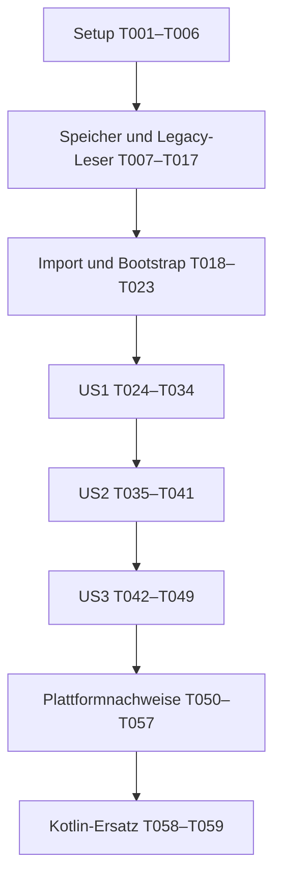

# Tasks: Registerkonten auf Android und iOS verwalten

**Input**: Design documents from `specs/001-registerkonten-verwalten/`.

**Prerequisites**: [plan.md](plan.md), [spec.md](spec.md), [research.md](research.md),
[data-model.md](data-model.md), [UI contract](contracts/account-management-ui.md),
[Migrationsvertrag](contracts/legacy-account-migration.md),
[Testausführung](contracts/native-test-execution.md), [quickstart.md](quickstart.md),
Constitution 2.0.0.

**Stand**: T001–T023 sowie T060/T073 im freigegebenen Android-Umfang abgeschlossen; verschobene iOS-Grundlagenprüfung T087 jetzt bestanden (31 Szenarien, 7 Prozessneustarts, Fehlerprobe). T024–T031 sowie T063/T074 implementiert und geprüft. Nächster sequenzieller Schritt: T032 ff. Vollständige Story-/Releaseabnahme bleibt offen.
Expo-Aufgaben nach Planpräzisierung A1/U1/U2/C1 aktualisiert; 59
Aufgaben werden nach tatsächlicher Umsetzung und Prüfung markiert; IDs beibehalten. Die bisherigen 40 erledigten
Kotlin-Aufgaben sind unverändert in [tasks-kotlin-archive.md](tasks-kotlin-archive.md)
archiviert; deren IDs und Nachweise gelten ausschließlich für die alte Implementierung.
Die IDs in dieser Datei gehören zum neuen Expo-Plan.

**Tests**: Spezifikation (User Scenarios & Testing, SC-001 bis SC-006) und
Constitution verlangen Prüfungen für Persistenz, Migrationen und Fehlerfälle.
Deshalb enthält diese Liste automatisierte und manuelle Nachweise. Testfälle vor
der zugehörigen Implementierung schreiben und zunächst den fehlenden Funktionsumfang
nachweisen; ein Importfehler allein ersetzt keinen fachlichen Negativtest.
Native Nachweise müssen echte SQLCipher-/SecureStore-Instanzen verwenden.

**Organization**: US1 = Konto speichern (P1), US2 = Konten überblicken (P2),
US3 = Konto löschen (P2). Alle Pfade sind relativ zum Repository-Stamm.
`[P]` bezeichnet parallele Arbeit in unterschiedlichen Dateien, sobald die jeweils
benannten Voraussetzungen erfüllt sind; keine automatische Agentendelegation.

## Phase 1: Setup (Shared Infrastructure)

**Purpose**: Neues Expo-Projekt neben der bisherigen Kotlin-App bereitstellen.
Constitution I und II; keine Löschung oder Änderung von Bestandskonten.

- [X] T001 Expo-Projekt unter `mobile/package.json` und `mobile/src/app/_layout.tsx` mit Expo SDK 58, React Native 0.88, React 19.3 und TypeScript strict in `mobile/tsconfig.json` initialisieren; Node 22 LTS ab 22.13 in `mobile/.nvmrc` festlegen, ohne die bestehende Kotlin-App zu überschreiben.
- [X] T002 SDK-kompatible Versionen von Expo Router, expo-dev-client, expo-sqlite, expo-secure-store und expo-crypto über expo install in `mobile/package.json` einbinden; Patchversionen und TypeScript im `mobile/package-lock.json` fixieren, SQLCipher auf Android UND iOS in `mobile/app.config.ts` aktivieren; Android API 24/compile 37/target 36 und iOS 16.4 als Zielgrenzen setzen.
- [X] T003 [P] Jest-Expo und React Native Testing Library in `mobile/jest.config.js`, `mobile/tests/setup.ts` und `mobile/package.json` einrichten; typecheck/test-Skripte und Trennung zwischen gemockten Komponenten-/Unit-Tests und echten nativen Integrationstests festlegen (nach T002).
- [X] T004 [P] Expo-Ausgaben, generierte `mobile/android/`/`mobile/ios/`, lokale Signierungsdateien und Geheimnisse in `.gitignore` ausschließen; `mobile/modules/`, `mobile/plugins/`, `mobile/migrations/` und Lockfile versionierbar lassen (nach T001).
- [X] T005 Profile development, native-test, preview und upgrade-test nach `contracts/native-test-execution.md` in `mobile/eas.json` und `mobile/app.config.ts` anlegen: Entwicklung `com.familyhub.app.dev`, nativer Testhost `com.familyhub.app.nativetest`, beide mit Dev Client; preview mit eingebettetem Bundle ohne Teststeuerung; upgrade-test mit `com.familyhub.app`, höherer versionCode und externer Fixture-Testsignatur, eingebettetem Bundle und explizitem Test-Flag nur im Testprofil. iOS-Bundle-IDs entsprechend trennen; reproduzierbare lokale Profilwahl und Test-Flag in app.config festlegen, keine Schlüssel versionieren (nach T002).
- [X] T006 Eigenständig baubare Kotlin-Testfixture unter `mobile/tests/fixtures/legacy-app/` aus Ausgangscommit `b7c62f8a80af78d54769a37c8f89b88234579b5e` einfrieren: Quellen/Ressourcen/Schema und eigene Wrapper-/Builddateien erhalten; Manifest mit Quellprüfsummen, getrennten Testergänzungen und Buildversionen in `mobile/tests/fixtures/legacy/fixture-manifest.json` anlegen (Gradle 8.14.3, AGP 8.13.2, Kotlin 2.3.20, Room 2.8.5, JDK 21, SDK 36, Build Tools 36.1.0). Instrumentierten Seeder unter `mobile/tests/fixtures/legacy-app/app/src/androidTest/java/com/familyhub/fixture/LegacySeedTest.kt` und `mobile/tests/tools/prepare-legacy-fixtures.sh` für zehn synthetische Konten/Formate 1–3 bereitstellen; Langwerte >65.535 UTF-Bytes nur Format 2/3, Format 1 innerhalb alter Grenze. Quelle ohne Root-app/Gradle oder Git-Historie baubar halten, keine APKs, privaten Signaturen oder echten Daten versionieren (nach T005).

**Checkpoint**: Projektstruktur, vier Buildprofile, Testkonfiguration und
eigenständig baubare synthetische Kotlin-Testfixture vorhanden; Kotlin-App bleibt unverändert nutzbar.

## Phase 2: Foundational (Blocking Prerequisites)

**Purpose**: Gemeinsame sichere Speicherung und erhaltende Android-Umstellung.
Constitution I, II und V sowie Qualitätsnachweise; FR-006/FR-007/FR-014/FR-015
und SC-006. Diese Phase blockiert alle Stories.

- [X] T007 [P] Native Bootstrap-/Schlüssel-/Schema-Tests in `mobile/tests/native/storageBootstrap.test.ts` vor Implementierung definieren: alle fünf priorisierten Regeln aus `data-model.md`, Ziel-DB mit fehlendem/falschem/unzugänglichem Key oder fehlendem/beschädigtem Marker, provisioning mit passender/fehlender/fremder Key-Kennung, ready ohne DB, iOS-Keychain-Rest und verwaiste WAL-/Journaldateien. Abbruch vor/nach Marker-, Key-, DB-/Schema- und ready-Schritt testen; kein Reset/Leerzustand bei inkonsistentem Bestand, kein Kontoschreiben vor ready; SQLCipher-/Schemafehler, Rollback und gemeinsame Unicode-/Kotlin-Identitätsfixtures abdecken.
- [X] T008 [P] Legacy-Decoder-/Quellschema-Tests unter `mobile/modules/legacy-accounts/android/src/androidTest/java/com/familyhub/legacy/LegacyAccountsTest.kt`, TS-Wiederaufnahmefälle in `mobile/tests/native/legacyMigration.test.ts` und Host-Exitcode-Tests in `mobile/tests/tools/nativeTestOrchestration.test.mjs` vor Implementierung definieren: Formate/Fixtures aus T006, leere Quell-DB ohne Alias, unbekannte Formate/Keys, Abbruch an jedem Import-/Bereinigungsschritt; fehlende/leere Kotlin- oder TS-Ergebnisgruppe, Timeouts und Fehlschläge müssen den Hostlauf scheitern lassen (FR-014/FR-015, SC-006; nach T006).
- [X] T009 Initiales SQLCipher-Schema in `mobile/migrations/001_accounts.sql` und gemeinsame Konto-/Ergebnistypen in `mobile/src/features/accounts/types.ts` anlegen: `id` „INTEGER PRIMARY KEY AUTOINCREMENT; bei Android-Übernahme alte ID erhalten“, `child_display_name` „TEXT NOT NULL; getrimmter, nicht leerer Anzeigename“, `child_key` „TEXT NOT NULL UNIQUE; kanonische Kinderkennung“, `school_code` „TEXT NOT NULL; CHECK auf `grundschule` oder `mittelschule`“, `username` und `password` jeweils „TEXT NOT NULL; nicht nur Leerzeichen, Eingabewert unverändert“. `legacy_migration` enthält „einen einzigen Datensatz: Quellversion, Quellkontoanzahl und Status `imported` oder `complete`; keine Zugangsdaten oder Kontonamen“. Gemeinsame Identitätsfunktion Trim/NFC/sprachunabhängige Kleinschreibung/NFC in `mobile/src/storage/childIdentity.ts` sowie injizierbaren Legacy-Quellvertrag in `mobile/src/storage/legacySource.ts` für Bootstrap/Import anlegen; gegen T007 prüfen.
- [X] T010 Versionierten SecureStore-Key-Datensatz mit derselben `installation_id` wie der Marker und zufälligem „32-Byte-Key“ in `mobile/src/storage/databaseKey.ts` implementieren; Format vor Nutzung validieren, neuen Key ausschließlich nach dauerhaftem provisioning-Marker erzeugen, schreiben und zurücklesen. Kennung `familyhub.database.key.v1`, Service `familyhub.database`, iOS `WHEN_UNLOCKED_THIS_DEVICE_ONLY`, `requireAuthentication: false`; temporäre Zugriffsstörung von fehlendem/fremdem Key unterscheiden, keine Klartextkopie auf Datenträger oder Key-Änderung je Konto (nach T009).
- [X] T011 [P] Lokales Expo-Modul für iOS-Backup-Ausschluss in `mobile/modules/storage-policy/ios/StoragePolicyModule.swift`, dessen Modulkonfiguration in `mobile/modules/storage-policy/expo-module.config.json` und TS-Schnittstelle in `mobile/modules/storage-policy/index.ts` implementieren; privaten DB-Ordner einschließlich Marker/Nebendateien vor Nutzung und nach Dateioperationen mit `isExcludedFromBackup` markieren und Flag prüfen, Fehler nach oben melden (parallel zu T010).
- [X] T012 [P] Android-Backup-Config-Plugin in `mobile/plugins/withAccountBackupRules.ts` implementieren: allowBackup=false plus Ausschlüsse für Ziel-/Legacy-DB, Journal/WAL/SHM, `installation.json`, temporäre Dateien und SecureStore-Preferences in Cloud-/Geräteübertragung; in `mobile/app.config.ts` registrieren. Mit Profilwahl aus T005 abstimmen, damit weder SecureStore-Standardregeln die Ausschlüsse überschreiben noch Test-Plugins unbeabsichtigt in preview aktiv werden (nach T005; parallel zu T010/T011).
- [X] T013 SQLCipher-Verbindung für `family_hub_v2.db` in `mobile/src/storage/database.ts` kapseln: nichtleeres `PRAGMA cipher_version` VOR jedem ersten Datenzugriff prüfen, Key vor Schemaabfragen setzen, Integrität prüfen, `foreign_keys=ON` und `secure_delete=ON` setzen, kontrollierte WAL-Checkpoints und Prepared Statements verwenden; Schreibtransaktionen exklusiv und nur über ihr Transaktionsobjekt ausführen (nach T009–T012).
- [X] T014 Versionierten Schema-Runner in `mobile/src/storage/migrateSchema.ts` mit `PRAGMA user_version=1` und SQL-Dateien aus `mobile/migrations/` implementieren; unabhängig vom alten Room-Strang, atomarer Commit, unbekannte höhere Version ablehnen und bei Fehler Bestand erhalten; keine destruktiven Resets (nach T013).
- [X] T015 Serialisierten Bootstrap in `mobile/src/storage/bootstrap.ts` und atomaren Markerzugriff in `mobile/src/storage/installationMarker.ts` implementieren: `installation.json` enthält „`format_version=1`“, „eine zufällige `installation_id`“ und „`phase` (`provisioning` oder `ready`), keine Geheimnisse“. Die fünf Regeln aus `data-model.md` in Prioritätsreihenfolge ohne Überschneidung auswerten; vorhandene Ziel-DB nie wegen Key-Fehler zurücksetzen, fertigen Marker ohne DB als Fehler behandeln, bei provisioning passenden Key wiederverwenden und Zugriffsfehler ohne Änderung melden. Erst Marker dauerhaft, dann Key schreiben/zurücklesen, dann DB/Schema prüfen, dann ready dauerhaft; vor ready keine Konten importieren/anlegen. Legacy-Erkennung über den Vertrag aus T009 injizieren, Adapter folgt mit T016/T020 (nach T014).
- [X] T016 Lokales Legacy-Expo-Modul unter `mobile/modules/legacy-accounts/expo-module.config.json`, `mobile/modules/legacy-accounts/index.ts` und `mobile/modules/legacy-accounts/android/src/main/java/com/familyhub/legacy/LegacyAccountsModule.kt` als Adapter zum Quellvertrag aus T009 anlegen; `family_hub.db` konsistent inklusive WAL über native SQLite-API lesen, nur Room-Schema 1 akzeptieren. Bekannte leere DB ohne jemals angelegten Alias zulassen, bei vorhandenen Zugangsdaten fehlenden Key als Fehler melden; iOS meldet keine Altdaten. Nur begrenzte Import-/Status-/Bereinigungsaufrufe anbieten, keine zweite Fachlogik (nach T008/T009).
- [X] T017 Geprüften Decoder aus `app/src/main/java/com/familyhub/app/security/CredentialsCipher.kt` nach `mobile/modules/legacy-accounts/android/src/main/java/com/familyhub/legacy/LegacyCredentialsDecoder.kt` für Formate 1, 2 und 3 übernehmen; vorhandenen Alias `family_hub_register_credentials_v1` ausschließlich lesen, niemals bei fehlendem Legacy-Key neu erzeugen; Langwerte und Sonderzeichen erhalten, Geheimnisse nicht loggen (nach T016).
- [X] T018 Android-Import in `mobile/src/storage/importLegacyAccounts.ts` umsetzen: Quelle validieren, IDs und kanonische Keys über T009 prüfen/erhalten, Ziel vor Import mit dauerhaftem ready-Marker voraussetzen; alle Konten mit unveränderten Zugangswerten zusammen mit Status imported in EINER exklusiven Zieltransaktion speichern. Bei Konflikten/Fehlern gesamten Import stoppen und Quelle erhalten; keine Klartextdatei, keine Neuerzeugung des Legacy-Alias, leeren Quellbestand explizit behandeln (FR-014/FR-015, SC-006; nach T015/T017).
- [X] T019 Verifikation und idempotente Bereinigung in `mobile/src/storage/finalizeLegacyMigration.ts` implementieren: Ziel mit sicher gespeichertem Key neu öffnen und alle Felder/Anzahl/IDs vergleichen; erst dann Quelle inklusive Nebendateien und danach alten Alias entfernen, Status `complete` zuletzt; jeden Absturzpunkt aus dem Migrationsvertrag wiederaufnehmen, Änderungen bis Abschluss sperren (nach T018).
- [X] T020 Legacy-Adapter, Import und Finalisierung in `mobile/src/storage/bootstrap.ts` verdrahten; Speicher-ready und Legacy-complete getrennt behandeln, vor abgeschlossener Übernahme/Bereinigung Änderungen sperren, fehlende Quelle nach imported als Bereinigungsphase erkennen, keine doppelte Übernahme oder Rückkehr zur alten aktiven DB; Fehler mit Retry statt vorgetäuschtem Leerstand melden (FR-014/FR-015; nach T019).
- [X] T021 Test-Config-Plugin `mobile/plugins/withNativeTestHarness.ts` und eigenen TS-Testentry `mobile/tests/native/NativeTestRunner.tsx` mit Fehler-/Prozessabbruch-Steuerung in `mobile/tests/native/faultInjection.ts` implementieren. Nur native-test bindet die versionierten Kotlin-androidTest-Quellen des Legacy-Moduls als SourceSet der erzeugten Host-App :app ein und setzt AndroidJUnitRunner plus passende AndroidX-Testabhängigkeiten; Plugin profilgebunden in `mobile/app.config.ts` registrieren. upgrade-test erhält nur ausdrücklich erforderliche Teststeuerung. TS-Suites mit echtem In-App-Runner/Adapter ausführen, nicht auf Jest-APIs im App-Prozess vertrauen. Normale development-/preview-/Produkt-Binaries enthalten weder Testentry, Seeder noch Fehlersteuerung; mit T008 und `contracts/native-test-execution.md` prüfen (nach T020).
- [X] T022 Storage-Provider sowie Start-/Migrations-/Fehleransicht mit Retry in `mobile/src/storage/StorageProvider.tsx` und `mobile/src/app/_layout.tsx` einbinden; UI bekommt keine Schlüssel/Zugangsdaten, Fehler zeigen nie einen falschen Leerzustand, während Import/Bereinigung sind Kontenänderungen gesperrt (nach T020).
- [X] T023 Android-Host-Steuerung und native Speicherbasis abschließen: reproduzierbare native-test-Generierung, Gerätewahl, APK-Wiederverwendung, Kotlin-/TS-Gruppen, echte Prozessneustarts und positive/absichtlich fehlschlagende Proben. Nachweis: 7 Kotlin- und 34 TS-Tests, beide Fehlerproben, 10 Neustarts sowie 7 Hosttests bestanden (verification-expo.md, 2026-11-04). iOS-Teil verbindlich nach T087 verschoben; dies ist keine iOS-Abnahme (nach T021/T022).

**Aktueller Ausführungsstand bei T023 (2026-11-04)**: Code T001–T022 implementiert;
Typprüfung, 22 Unit-Tests und 7 Hosttests bestanden. Der Fehler
`legacy-formats-1-2-3` / `storage-database` ist im schreibgeschützten nativen
Quellleser behoben. Der gezielte Test und alle 34 Android-TS-Szenarien bestehen
mit der korrigierten installierten App, einschließlich 10 automatischer
Prozessneustarts und TS-Fehlerprobe. Nach erfolgreicher Test-APK-Installation
besteht nun auch der vollständige Android-Lauf: 7 Kotlin-Tests (einschließlich
WAL-/Leerquellen-Regressionen), 34 TS-Szenarien, beide Fehlerproben, keine
Fehler oder übersprungenen Tests. Beide unveränderten APKs wurden erhalten.
iOS benötigt weiterhin macOS/Xcode. Der Nutzer hat diesen Nachweis nach T087
verschoben; T023/T060/T073 sind ausschließlich im Android-Umfang abgeschlossen.
Details: [verification-expo.md](verification-expo.md).
Die Android-Story-Implementierung ist freigegeben; T087 ist vor T032/T034 und jeder plattformübergreifenden Abnahme auszuführen.

**Checkpoint aktualisiert**: Android-Speicherbasis und Migrationsvertrag nativ geprüft. Die verschobene iOS-Prüfung T087 ist inzwischen bestanden; Nachweis unten und in verification-expo.md. Vollständige Story-/Plattformfreigabe und Release bleiben an die übrigen Gates gebunden. Der vorstehende Vertagungsvermerk beschreibt die frühere Prüfsequenz.

## Phase 3: User Story 1 – Schulkonto für ein Kind speichern (Priority: P1)

**Goal**: Genau ein Schulkonto je Kind offline geschützt speichern und nach Neustart
wiederfinden. Constitution I/II/V; FR-001 bis FR-007, FR-011 bis FR-013.

**Independent Test**: Im Preview-Build auf Android und iOS ein Konto im Flugmodus
anlegen, App vollständig beenden und ohne Metro/Netz neu starten: Kind und Schule
einmal sichtbar, keine Zugangsdaten in der Übersicht. Fehlende Angaben und Duplikate
werden verständlich abgewiesen.

### Tests for User Story 1

- [X] T024 [P] [US1] Validator-Tests in `mobile/tests/unit/accountValidation.test.ts` mit `mobile/tests/fixtures/child-normalization.json` schreiben: Leer-/Whitespace-Eingaben, nur erlaubte Schulen, `Anna`/` anna `/`ANNA`, NFC/Kleinschreibung/NFC, Kotlin-Trim-Kompatibilität, Umlaute/I/İ/Unicode-Leerzeichen, unveränderte Benutzername-/Passwort-Randzeichen; gemeinsame Identitätsfunktion aus Foundation gegen dieselben Kotlin-Fälle prüfen (nach Foundation).
- [X] T025 [P] [US1] Native Kontoanlage-Tests in `mobile/tests/native/accountCreation.test.ts` definieren: zehn Konten, konkurrierende Duplikate, Rollback bei Fehler, Prozessabbruch vor/nach Commit, Wiederöffnung offline und große Zugangswerte; fehlende/falsche Keys und nicht verfügbare Verschlüsselung erzeugen keinen Teilbestand (nach Foundation).
- [X] T026 [P] [US1] Formular-/UI-Vertrag in `mobile/tests/components/CreateAccountScreen.test.tsx` testen: Feldfehler, Schulwahl, verdecktes Passwort, Doppelklickschutz, verständliche Speicher-/Duplikatfehler, Rückkehr nach Commit und Verwerfen lokaler Geheimnisse bei Erfolg/Verlassen (nach Foundation).

### Implementation for User Story 1

- [X] T027 [US1] Reine Validierung in `mobile/src/features/accounts/accountValidation.ts` implementieren: „Fehlende/blanke Angaben vor Speicherung am betroffenen Feld melden“, Anzeigename außen trimmen, `child_key` NFC/sprachunabhängige Kleinschreibung/NFC, gemeinsame Identitätsfunktion aus `mobile/src/storage/childIdentity.ts` verwenden, nie gerätelokales Lowercasing; „Benutzername und Passwort nur zur Prüfung auf leere Eingaben trimmen, ihre gespeicherten Werte einschließlich Randzeichen unverändert erhalten“; Schulen nur `grundschule`/`mittelschule` (nach T024).
- [X] T028 [US1] Repository-Anlage und minimale sichere Summary-Abfrage in `mobile/src/features/accounts/accountRepository.ts` implementieren: exklusive INSERT-Transaktion, UNIQUE-Verletzung gezielt als Duplikat, andere Fehler getrennt, Erfolg erst nach Commit. Commit-Unklarheit bereits hier durch erneutes Lesen auflösen, vollständigen Zielstand erkennen statt blind erneut zu schreiben; bei Abbruch nur vorheriger oder vollständig neuer Zustand. Kein SecureStore-Schreiben pro Konto und kein Registerzugriff (nach T023/T025/T027).
- [X] T029 [US1] Formular-Hook in `mobile/src/features/accounts/useCreateAccount.ts` anlegen: lokale Eingaben und Feldfehler, atomarer Speichervorgang, Busy-Zustand und Geheimnisse beim Verlassen/Erfolg verwerfen; keine Persistierung in Navigation oder globalem UI-State (nach T028).
- [X] T030 [US1] Zugängliches Formular mit sicherem Passwortfeld und Tastatur-/Scroll-Erreichbarkeit in `mobile/src/features/accounts/CreateAccountScreen.tsx` umsetzen; Kind/Schule und klar beschriftete Speichern-/Zurück-Aktionen, keine Klartext-Geheimnisse in Fehlermeldungen (nach T026/T029).
- [X] T031 [US1] Minimale Kontoübersicht mit Hinzufügen-Aktion in `mobile/src/features/accounts/AccountListScreen.tsx`, Startroute `mobile/src/app/index.tsx` und Anlageroute `mobile/src/app/accounts/create.tsx` verbinden; nach erfolgreicher Anlage und Neustart ausschließlich ID/Kind/Schule aus der DB lesen, grundlegende Lade-/Fehlerzustände ohne falschen Leerstand anbieten (nach T030).
- [ ] T032 [US1] Offline-Anlage-/Neustart-/Duplikatablauf in `mobile/.maestro/create-account.yaml` implementieren und mit eingebettetem Bundle im normalen Preview-Build ohne Metro auf Android/iOS ausführen; T024/T026 separat mit Jest und T025 über native-test-Runner aus T023 ausführen, Ergebnisse nicht zwischen Buildprofilen verwechseln (nach T031).
- [ ] T033 [US1] Commit-Abbruchfälle aus T025 und UI-Verhalten nach Wiederaufnahme erneut mit `mobile/tests/native/accountCreation.test.ts` nativ prüfen; festgestellte Fehler in `mobile/src/features/accounts/accountRepository.ts` beheben. Das bereits in T028 umgesetzte Verhalten muss vor/nach Commit den tatsächlichen Bestand zeigen und darf ein vorhandenes oder migriertes Konto nicht doppelt anlegen (nach T032).
- [ ] T034 [US1] Eigenständige US1-Abnahme einschließlich SC-002/SC-003 auf Android/iOS durchführen und Ergebnisse/Buildprofile in `specs/001-registerkonten-verwalten/verification-expo.md` ergänzen; Anlage nach erfolgreicher Android-Übernahme prüfen und sicherstellen, dass noch fehlgeschlagene/ungeprüfte Übernahme gemäß FR-015 Änderungen verhindert. Die vollständige FR-014/SC-006-Updateabnahme bleibt zusätzlich Pflicht in T054 (nach T033).

**Checkpoint**: US1 ist mit minimaler Übersicht vollständig demonstrierbar;
US2-Komfortfunktionen und US3 sind dafür nicht erforderlich.

## Phase 4: User Story 2 – Gespeicherte Konten überblicken (Priority: P2)

**Goal**: Alle Konten offline genau einmal mit Lade-, Leer- und Fehlerzustand zeigen.
Constitution I/II/IV; FR-008, FR-012 bis FR-015 und SC-006 (Android-Update).

**Independent Test**: Zwei synthetisch vorbereitete Konten ohne Anlegeformular
öffnen: beide Kinder/Schulen sehen, keine Zugangsdaten. Leerer Bestand zeigt Einstieg;
Lesefehler zeigt Retry und niemals eine scheinbar erfolgreiche leere Liste.
Übernommene Android-Konten bleiben zugeordnet; fehlgeschlagene Übernahme erhält
Daten und sperrt Änderungen. Eine iOS-Neuinstallation beginnt leer.

### Tests for User Story 2

- [ ] T035 [P] [US2] Sichere Summary-Projektion, eindeutige Zeilen, vorbereitete zehn Konten nach Wiederöffnung und echte Lesefehler in `mobile/tests/native/accountOverview.test.ts` testen; UI-Modell enthält keine Zugangsdaten. Zusätzlichen Android-Fall für erfolgreich übernommene Konten und fehlgeschlagene Übernahme mit unverändertem Bestand, gesperrten Änderungen und keinem falschen Leerstand aufnehmen (FR-014/FR-015; nach Foundation).
- [ ] T036 [P] [US2] Lade-/Leer-/Mehrfach-/Fehlerzustand, Retry, Aktualisierung nach Vordergrundwechsel und skalierte Schrift in `mobile/tests/components/AccountListScreen.test.tsx` testen; UI-Vertrag und neue US2-Akzeptanzszenarien aus `spec.md` abdecken: Übernahme läuft/fehlgeschlagen darf keine erfolgreiche leere Kontenübersicht oder aktive Änderungen anzeigen (nach T031).

### Implementation for User Story 2

- [ ] T037 [US2] Zusammenfassungsabfrage in `mobile/src/features/accounts/accountQueries.ts` ausbauen und in `mobile/src/features/accounts/accountRepository.ts` wiederverwenden: nur ID/Kind/Schule, deterministisch nach Kind/ID ordnen, keine Geheimnisse in Ergebnissen oder Fehlern, keine Umdeutung eines DB-Fehlers in eine leere Liste (nach T028/T035).
- [ ] T038 [US2] Listen-Hook mit getrennten Lade-/Erfolg-/Fehlerzuständen und Retry in `mobile/src/features/accounts/useAccounts.ts` implementieren; nach Mutation und App-Rückkehr in den Vordergrund neu laden, veraltete asynchrone Ergebnisse nach Unmount verwerfen (nach T037).
- [ ] T039 [US2] `mobile/src/features/accounts/AccountListScreen.tsx` um vollständige Mehrfachübersicht, hilfreichen Leerzustand, Retry und zugängliche Labels erweitern; kleine Displays und große Systemschrift berücksichtigen, keinen Abgleichstatus erfinden (nach T036/T038).
- [ ] T040 [US2] Startroute und Rückkehr aus dem Formular in `mobile/src/app/index.tsx` auf den gemeinsamen Listen-Hook integrieren und `mobile/.maestro/account-overview.yaml` für vorbereitete Daten, Offline-Neustart und Leerzustand ergänzen (nach T039).
- [ ] T041 [US2] Unabhängige US2-Abnahme mit vorbereiteten Daten inklusive T035/T036 und Vordergrundwechsel auf Android/iOS durchführen; Android-Migrationszustände, Retry und Änderungsverbot gemäß FR-014/FR-015 ausdrücklich mitprüfen, SC-006 separat dem vollständigen Updatelauf T054 zuordnen. Ergebnisse in `specs/001-registerkonten-verwalten/verification-expo.md` dokumentieren (nach T040).

**Checkpoint**: Übersicht ohne Nutzung des Formulars prüfbar; bestätigte Löschung
ist noch keine Voraussetzung für US2.

## Phase 5: User Story 3 – Schulkonto löschen (Priority: P2)

**Goal**: Ein Konto nach Bestätigung vollständig entfernen, Abbruch folgenlos lassen
und Neueinrichtung für dasselbe Kind erlauben. Constitution II; FR-009 bis FR-012, FR-015 und Android-SC-006.

**Independent Test**: Ein vorbereitetes Konto offline zunächst mit Abbruch behalten,
dann bestätigt löschen; nach Neustart bleibt es entfernt. Andere Konten bleiben
erhalten, Neueinrichtung desselben Kindes ist möglich, Altdaten erscheinen nicht wieder.

### Tests for User Story 3

- [ ] T042 [P] [US3] Native Löschung in `mobile/tests/native/accountDeletion.test.ts` testen: Konto samt Zugangsdaten entfernen, andere Konten erhalten, Cascade für synthetische abhängige Testdaten, Rollback/Prozessabbruch und erneute Anlage desselben Keys; nach Legacy-Import gelöschtes Konto darf nicht wieder erscheinen (nach Foundation).
- [ ] T043 [P] [US3] Dialogvertrag in `mobile/tests/components/DeleteAccountDialog.test.tsx` testen: Kind/Schule, Abbrechen unverändert, Bestätigung, Doppelklickschutz, Fehler mit Retry und keine Zugangsdaten (nach T039).

### Implementation for User Story 3

- [ ] T044 [US3] Löschoperation nach stabiler Konto-ID in `mobile/src/features/accounts/deleteAccount.ts` implementieren und in `mobile/src/features/accounts/accountRepository.ts` anbinden: Konto und referenzierende Einträge in exklusiver Transaktion, `ON DELETE CASCADE` nutzen, Erfolg nach Commit, bei Fehler Rollback, DB-Key auch nach letzter Kontolöschung behalten (nach T042/T037).
- [ ] T045 [US3] Auswahl/Bestätigung/Abbruch sowie Busy-/Fehler-/Retry-Zustand in `mobile/src/features/accounts/useDeleteAccount.ts` implementieren; nach Commit Liste aktualisieren und bei unklarem Commit tatsächlichen Bestand lesen (nach T044).
- [ ] T046 [US3] Zugänglichen Bestätigungsdialog in `mobile/src/features/accounts/DeleteAccountDialog.tsx` mit Kind/Schule und den Aktionen „Abbrechen“/„Löschen“ bauen; Fokusführung und deaktivierte Mehrfachauslösung während Operation beachten (nach T043/T045).
- [ ] T047 [US3] Löschaktionen/Dialog in `mobile/src/features/accounts/AccountListScreen.tsx` und `mobile/src/app/index.tsx` integrieren; erst nach Commit aus der Liste entfernen, bei Fehler tatsächlichen Bestand erhalten und andere Konten unverändert lassen (nach T046).
- [ ] T048 [US3] Ende-zu-Ende-Abbruch-/Lösch-/Neuanlageablauf in `mobile/.maestro/delete-account.yaml` ergänzen; Neustart nach Löschung und Neustart nach migriertem Altbestand auf Android prüfen, gemeinsame Löschfälle zusätzlich auf iOS ausführen (nach T047).
- [ ] T049 [US3] T042/T043/T048 einschließlich Cascade-/Rollback- und Prozessabbruchfällen nativ ausführen; SC-004 auf Android/iOS sowie Android-SC-006-Teilfall „gelöschtes Konto erscheint nicht erneut aus dem Altbestand“ in `specs/001-registerkonten-verwalten/verification-expo.md` dokumentieren; fehlgeschlagene Übernahme darf keine Löschung zulassen (FR-015; nach T048).

**Checkpoint**: Alle drei Stories funktionieren; verbleibende Aufgaben sichern den
plattformübergreifenden Ersatz und die bisherige Kotlin-Buildkette ab.

## Phase 6: Polish & Cross-Cutting Concerns

**Purpose**: Datenschutz, Zugänglichkeit, native Migration und Ersatz nachweisen.
Constitution I–V; keine Store-Veröffentlichung oder Feature-Erweiterung.

- [ ] T050 [P] Generierte Backup-Regeln und reale native Backup-Flags in `mobile/tests/native/backupPolicy.test.ts` prüfen: Android Cloud-/Geräteübertragung und iOS-Verzeichnis/Dateien nach Schreiben und Wiederöffnung, SecureStore ausgeschlossen; Erkenntnisse unter `mobile/tests/artifacts/backup-policy/` ohne Geheimnisse ablegen (nach T049).
- [ ] T051 [P] Schlüssel-Lebenszyklus, Neuinstallation und Geheimnisschutz in `mobile/tests/native/storageLifecycle.test.ts` prüfen: versionierter Marker-/Key-Datensatz mit Kennung, iOS-Keychain-Reste ohne DB, fehlender/beschädigter Marker und bestehende DB ohne passenden Key, provisioning-Wiederaufnahme, ready ohne DB, verwaiste Nebendateien sowie Android-Neuinstallation. DB/WAL/SHM/Logs ohne Klartext, gewöhnliches SQLite ohne Key darf DB nicht lesen, SQLCipher-Ausfall bleibt erkennbar; kein destruktiver Reset und keine Zusage forensischer Flash-Löschung (nach T049).
- [ ] T052 [P] Verschlüsselte Schema-Fixtures und Runner-Tests in `mobile/tests/native/schemaMigration.test.ts` und `mobile/tests/fixtures/schema/` vervollständigen: initiale Version, vorliegende Altversionen mit zehn Konten, Daten-/ID-Erhalt, Rollback und Ablehnung unbekannter neuer Version; für jede spätere Schemaänderung neue explizite Migration plus Fixture fordern (nach T049).
- [ ] T053 [P] TalkBack-/VoiceOver-, zweifache Systemschrift-, Tastatur- und Kleinbildschirmabläufe in `mobile/.maestro/accessibility.yaml` und manueller Prüfliste `mobile/tests/accessibility.md` erfassen; Labels, Fokus und Erreichbarkeit aller drei Stories auf beiden Plattformen prüfen und gefundene UI-Fehler in den betreffenden Dateien unter `mobile/src/features/accounts/` beheben (nach T049).
- [ ] T054 Vollständigen Offline-Update-Test für FR-014/FR-015 und SC-006 in `mobile/tests/tools/verify-android-upgrade.sh` umsetzen/ausführen: Fixture aus T006 anhand Manifest prüfen/selbstständig bauen, alte App und Test-APK installieren, Seeder per AndroidJUnitRunner starten, APK-Signaturfingerprints vergleichen, signaturgleichen upgrade-test-Build ohne Deinstallation installieren. Zehn Konten/Formate 1–3, Unicode/Langwerte, leere Quelle ohne Alias und jeden Abbruchpunkt testen; IDs/Zuordnung/exakte Zugangswerte müssen erhalten bleiben, Quelle/Alias erst nach Zielprüfung entfernt. Separate IDs/Signaturen/API 23 getrennt ausweisen. Vor Root-Entfernung denselben Lauf aus isoliertem frischem Checkout OHNE aktive Root-app/Gradle-Dateien und ohne historische Git-Objekte nachweisen; Skripte brauchen nur Fixture-/Expo-Pfade (nach T050–T053).
- [ ] T055 Preview-Builds ohne Metro für Android/iOS erstellen und Performance nach `plan.md` mit `mobile/.maestro/performance.yaml` sowie geeigneter lokaler Zeitmessung prüfen: zehn Konten nach Speicherinitialisierung ≤1 s, Speichern/Löschen jeweils ≤2 s; Kaltstart-/Importzeit separat in `specs/001-registerkonten-verwalten/verification-expo.md` dokumentieren und gemessene Überschreitungen beheben (nach T054).
- [ ] T056 Nutzungstests SC-001 und SC-005 mit je zehn Personen pro Plattform gemäß `specs/001-registerkonten-verwalten/quickstart.md` durchführen und Erfolgsquote in `specs/001-registerkonten-verwalten/verification-expo.md` festhalten: mindestens 9/10 legen Konto ohne Anleitung in drei Minuten an und mindestens 9/10 erkennen Kind/Schule/Speichern/Löschen bei großer Schrift; bis tatsächlicher Durchführung offen lassen (nach T055).
- [ ] T057 `specs/001-registerkonten-verwalten/quickstart.md` mit tatsächlichen Skripten/Profilen abgleichen, alle automatischen/manuellen Abläufe ausführen und vollständige Plattform-/Versions-/Grenzenberichte in `specs/001-registerkonten-verwalten/verification-expo.md` abschließen. Native Testgruppen, FR-014/FR-015/SC-006, unabhängige Fixture-Baustufe und Preview ohne Testschnittstellen explizit nachweisen; `mobile/` auf unnötige Berechtigungen, Register-/Server-Abhängigkeit und Geheimnis-Logs prüfen (nach T056).
- [ ] T058 Erst nach erfolgreichen Nachweisen T023/T034/T041/T049–T057 und bestandenem Fixture-/Upgrade-Lauf ohne aktive Root-Buildkette die eigenständige Produkt-Kotlin-App unter `app/` und alte Root-Buildkette (`build.gradle.kts`, `settings.gradle.kts`, `gradle/`, `gradle.properties`, `gradlew`, `gradlew.bat`) in reviewbarer Änderung entfernen. `mobile/tests/fixtures/legacy-app/` samt eigenem Wrapper, Seeder, Manifest/Skripten, Legacy-Modul unter `mobile/modules/legacy-accounts/`, `specs/001-registerkonten-verwalten/verification.md` und `tasks-kotlin-archive.md` erhalten; direkte Updates müssen weiter funktionieren.
- [ ] T059 Expo-Build-/Startanleitung und Upgradegrenzen in `mobile/README.md` abschließen und nach T058 typecheck, Unit-/beide Android-native-/iOS-native Tests sowie Preview-Builds erneut prüfen; `mobile/tests/tools/prepare-legacy-fixtures.sh` und `mobile/tests/tools/verify-android-upgrade.sh` aus frischem Checkout mit erhaltener Fixture ohne Root-Kotlin-Projekt erneut ausführen. Finalen Ersatzstatus, Signatur-/Buildversionen und Grenzen in `specs/001-registerkonten-verwalten/verification-expo.md` festhalten; keine Store-Veröffentlichung auslösen.

**Checkpoint**: Erst nach tatsächlichen Nachweisen gilt der Ersatz als abgeschlossen.
Fehlende Geräte, Signaturen oder Nutzungstests transparent dokumentieren, betroffene
Tasks offen lassen und die alte Kotlin-App bis zum erfüllten Entfernungsgate erhalten.

## Dependencies & Execution Order

### Phase Dependencies

- Setup: T001 → T002; T003 und T004 nach ihren Voraussetzungen parallel;
  T005 → T006. Fixture-Build und synthetischer Seeder sind unabhängig von Expo.
- Foundation-Testfälle T007/T008 vor der Implementierung definieren. T009
  liefert Schema, gemeinsame Identität und injizierbaren Legacy-Quellvertrag.
- T010/T011/T012 können danach in getrennten Dateien parallel laufen; zusammen
  Voraussetzung für T013 → T014 → T015. T015 hängt nur vom Vertrag T009 ab,
  nicht vom erst später implementierten Legacy-Adapter.
- T016 → T017 kann parallel zum TS-Speicheraufbau erfolgen, benötigt T008/T009.
  T018 benötigt T015/T017; dann T019 → T020. Danach T021 und T022 in getrennten
  Dateien, anschließend T023 für tatsächliche Orchestrierung und Plattformnachweise.
- US1: T024–T026 parallel nach Foundation, dann T027 → T028 → T029 → T030 →
  T031 → T032 → T033 → T034. Commit-Wiederaufnahme wird bereits in T028
  implementiert, bevor T032 die Suites ausführt; T033 sichert die Fehlerfälle ab.
- US2: T035 nach Foundation, T036 nach T031; T037 → T038 → T039 → T040 → T041.
- US3: T042 nach Foundation, T043 nach T039; T044 → T045 → T046 → T047 →
  T048 → T049. Die sequentielle Story-Reihenfolge verhindert gemeinsame Dateikonflikte.
- Polish: T050–T053 parallel nach allen Stories; dann T054 → T055 → T056 →
  T057 → T058 → T059. Entfernungsgate T058 setzt alle tatsächlichen Nachweise
  einschließlich selbständigem Fixture-/Upgrade-Lauf ohne Root-App voraus.

### User Story Dependencies

- **US1**: Benötigt Foundation und deren gemeinsame Kinderidentität. Liefert
  eigene minimale Übersicht und benötigt US2/US3 nicht.
- **US2**: Nutzt Repository und minimale Anzeige aus US1, ist mit vorbereiteten
  Konten unabhängig von der Anlegeoberfläche testbar.
- **US3**: Nutzt Repository und Listenintegration aus US1/US2, ist mit vorbereiteten
  Konten unabhängig von der Anlegeoberfläche testbar. Neuanlage wird über das
  Repository beziehungsweise die fertige US1 geprüft.



### Within Each User Story

Tests vor Implementierung definieren, dann Validator/Repository, Hook, Oberfläche
und Routing integrieren. Native Tests nach Integration tatsächlich ausführen.
Abhängigkeiten in Klammern und dieser Abschnitt haben Vorrang vor bloßer ID-Sortierung.
Ein Checkpoint erfordert bestandene Story-Nachweise, nicht nur vorhandene Dateien.

### Parallel Opportunities

T003/T004 nach ihren Voraussetzungen; T007/T008 in verschiedenen Testdateien;
T010/T011/T012 mit getrennten Konfigurationsverantwortungen; T021/T022 nach T020; Legacy-Modul T016/T017
parallel zum TS-Speicheraufbau. Testpaare/-gruppen pro Story und T050–T053
arbeiten an getrennten Dateien.
Änderungen derselben Datei, besonders Repository, Listenansicht und
`verification-expo.md`, stets sequenziell integrieren.

## Parallel Example: User Story 1

```text
Nach Foundation: T024 Validator-Tests | T025 native Anlage-/Fehlertests | T026 Formular-Vertragstests
Danach: T027 Validator → T028 Repository → T029 Hook → T030 Formular → T031 Routen → T032–T034 Abnahme
```

## Parallel Example: User Story 2

```text
Nach Foundation und minimaler US1-Übersicht:
T035 native Projektion/Lesefehler | T036 Komponentenansicht/Retry
Danach: T037 Abfragen → T038 Hook → T039 Ansicht → T040 Routing → T041 Abnahme
```

## Parallel Example: User Story 3

```text
Nach Foundation und US2-Übersicht:
T042 native Löschung/Rollback | T043 Dialogvertrag
Danach: T044 Repository → T045 Hook → T046 Dialog → T047 Liste → T048–T049 Abnahme
```

## Implementation Strategy

### MVP First (User Story 1 Only)

1. Setup und Foundation einschließlich gemeinsamer Identität und erhaltender
   Android-Übernahme aufbauen und auf beiden Plattformen prüfen.
2. US1 implementieren, offline mit eingebettetem Bundle nach Prozessneustart
   prüfen. Dies ist der kleinste Demonstrationsumfang für den neuen Stack.
3. Alte Kotlin-App bis zum vollständigen Ersatz weiter als Referenz behalten.
   Ein US1-Demoerfolg allein erlaubt noch keine Entfernung der alten App.

### Incremental Delivery

1. US2 ergänzt vollständige Übersicht und ehrliche Lesefehler.
2. US3 ergänzt bestätigte atomare Löschung ohne Wiederauftauchen von Altdaten.
3. Gemeinsame Sicherheits-, Zugänglichkeits-, Performance- und Nutzungstests
   abschließen; erst dann alte App entfernen und verbleibende Buildkette prüfen.

## Requirement Coverage

„Abgedeckt“ bezeichnet geplante Arbeit, keine bereits bestandenen Tests.

| Anforderung / Kriterium | Zugeordnete Aufgaben |
|------------------------|----------------------|
| FR-001 Serverfreier Start | T022, T031, T057 |
| FR-002 Anlagefelder | T024, T026–T032 |
| FR-003 Unterstützte Schulen | T009, T024, T027 |
| FR-004 Pflichtfelder | T024, T026, T027, T030 |
| FR-005 Ein-Konto-Regel | T009, T024, T025, T028 |
| FR-006 Persistenz und Schema-Migration | T007, T009–T023, T025, T052 |
| FR-007 Geheimnisschutz | T010–T013, T021, T026, T050, T051, T057 |
| FR-008 Übersicht/Leerzustand | T031, T035–T041 |
| FR-009 Löschbestätigung/Abbruch | T043, T045–T048 |
| FR-010 Vollständige Löschung | T042, T044, T048, T049 |
| FR-011 Atomare Änderungen | T025, T028, T033, T042, T044, T045 |
| FR-012 Offline ohne Registerprüfung | T028, T032, T040, T048, T057 |
| FR-013 Schrift/Bedienbarkeit | T030, T036, T039, T046, T053 |
| FR-014 Android-Übernahme | T006, T008, T016–T020, T023, T034, T035, T041, T054 |
| FR-015 Erhalt/Retry/Änderungssperre | T007, T008, T015, T018–T023, T034–T036, T041, T049, T054 |
| SC-001 Einrichtung durch Testpersonen | T056 |
| SC-002 Zehn Konten nach Neustart | T025, T032, T034, T035, T041 |
| SC-003 Eindeutigkeit | T024, T025, T028, T034 |
| SC-004 Löschung/Neueinrichtung | T042, T048, T049 |
| SC-005 Große Schrift/Passwortfreiheit | T026, T036, T043, T053, T056 |
| SC-006 Android-Update samt Wiederaufnahme | T006, T008, T018–T020, T023, T041, T049, T054, T059 |

SC-001 bis SC-005 auf beiden Plattformen prüfen; SC-006 nur für unterstützte
Android-Updates. Nutzungstests mit Personen bleiben bis tatsächlicher Durchführung
offen; Instrumentierung und automatische UI-Tests sind kein Ersatz dafür.

## Notes

- Kein Registerabgleich, Aufgaben-/Mitteilungsspeicher, Export/Import,
  Hintergrundabgleich oder Benachrichtigungsfeature in dieser Liste. Die lokale
  technische Übernahme beim App-Update ist kein nutzerseitiger Datenexport.
- Die Feature-Kriterien gelten auf Android und iOS. Nicht ausgeführte native
  oder personengestützte Prüfungen werden nicht als erledigt markiert.
- Neue Konfiguration wird über Plugins/Module reproduzierbar erzeugt, nicht
  ausschließlich in generierten nativen Projektdateien editiert.
- Historische Kotlin-Tasks und Prüfberichte bleiben von neuen Ergebnissen getrennt.


## Phase 7: Convergence

Verbleibende Arbeit der ursprünglichen Tasks; deren Abhängigkeiten und Plattform-Gates gelten weiterhin. Überlappende Aufgaben gemeinsam erfüllen, nicht doppelt implementieren.

- [X] T060 Android-Anteil der nativen Speicherabnahme aus T023 abgeschlossen: beide Ergebnisgruppen und Fehlerproben tatsächlich bestanden und dokumentiert. iOS-Anteil nach T087 verschoben; Android-Story-Implementierung freigegeben, plattformübergreifende Abnahme bleibt gesperrt bis T087.
- [ ] T061 CRITICAL: Bestätigte atomare Kontolöschung aus T042–T049 in mobile/src/features/accounts/deleteAccount.ts, accountRepository.ts, useDeleteAccount.ts, DeleteAccountDialog.tsx und AccountListScreen.tsx implementieren: Abbruch folgenlos, stabile ID, abhängige Daten und Zugangsdaten vollständig entfernen, Commit-Unklarheit durch Lesen auflösen, andere Konten und DB-Key erhalten und Neueinrichtung erlauben; Voraussetzungen T037/T039 beachten per Constitution II, FR-009/FR-010/FR-011, US3/AC1–AC3, T044–T047 (missing)
- [ ] T062 CRITICAL: Native Backup-/Schlüssellebenszyklus-/Schema-Nachweise in mobile/tests/native/backupPolicy.test.ts, storageLifecycle.test.ts und schemaMigration.test.ts samt mobile/tests/fixtures/schema/ gemäß T050–T052 implementieren und auf beiden Plattformen ausführen; tatsächliche Backup-Flags, Klartextfreiheit von DB/Nebendateien/Logs, Zugriff ohne Key, Neuinstallation, erhaltende Fehlerbehandlung und Schema-Rollback prüfen und Ergebnisse bereinigt dokumentieren per Constitution II, FR-006/FR-007, T050–T052 (missing)
- [X] T063 Offline-Kontoanlage gemäß T027–T031 nach Foundation-Gate implementieren: mobile/src/features/accounts/accountValidation.ts, accountRepository.ts, useCreateAccount.ts, CreateAccountScreen.tsx und mobile/src/app/accounts/create.tsx erstellen und Platzhalter in mobile/src/app/index.tsx durch minimale Übersicht ersetzen; Pflichtfelder, Schul-Allowlist, gemeinsame Unicode-Identität, UNIQUE-Duplikatfehler, atomaren Commit einschließlich Wiederaufnahme, Busy-Zustand und Verwerfen lokaler Geheimnisse umsetzen per FR-001–FR-005/FR-011/FR-012, US1/AC1–AC4, T027–T031 (missing)
- [ ] T064 Vollständige sichere Übersicht aus T037–T040 in mobile/src/features/accounts/accountQueries.ts, useAccounts.ts und AccountListScreen.tsx implementieren und mit mobile/src/app/index.tsx verbinden: ausschließlich ID/Kind/Schule deterministisch projizieren, Lade-/Leer-/Fehlerzustände trennen, Retry und Vordergrundaktualisierung anbieten, veraltete Antworten verwerfen und fehlgeschlagene Migration weiterhin sperren per FR-008/FR-012–FR-015, US2/AC1–AC6, T037–T040 (missing)
- [ ] T065 Foundation-Testabdeckung in mobile/tests/native/nativeContext.ts, scenarios.json, storageBootstrap.test.ts und legacyMigration.test.ts vervollständigen: Abbrüche vor Marker-/Key-Erstellung sowie während DB-/Schemaaufbau, fehlender/beschädigter Marker und verwaiste Journalvarianten, gesperrter SecureStore während provisioning, Schreibsperre vor ready, native Quellschemafehler und Unterbrechungen während Verifikation/Bereinigung mit Bestandserhalt prüfen; erforderliche Runner-Fallzahlen und Hosttests synchronisieren per FR-006/FR-014/FR-015, T007/T008 (partial)
- [ ] T066 Noch fehlende Story-Nachweise aus T024–T026/T032–T036/T041–T043/T048–T049 implementieren und nach den ursprünglichen Abhängigkeiten ausführen: mobile/tests/unit/accountValidation.test.ts mit gemeinsamen Kotlin-/Unicode-Fixtures, mobile/tests/components/ für Formular/Liste/Dialog, mobile/tests/native/accountCreation.test.ts/accountOverview.test.ts/accountDeletion.test.ts und mobile/.maestro/create-account.yaml/account-overview.yaml/delete-account.yaml; echte Fehler, konkurrierende Duplikate, zehn Konten nach Offline-Prozessneustart, Commit-Abbrüche, Cascade, Abbruch/Neueinrichtung und Android-Migrationssperren prüfen, native Runner erweitern und separate Plattformberichte ablegen per US1/AC1–AC4, US2/AC1–AC6, US3/AC1–AC3, SC-002–SC-004, T024–T026/T032–T036/T041–T043/T048–T049 (missing)
- [ ] T067 Vollständigen signaturgleichen Offline-Android-Upgradeablauf in mobile/tests/tools/verify-android-upgrade.sh gemäß T054 erstellen und ausführen: unabhängige Fixture prüfen/bauen/seedern, Signaturen vergleichen, Update ohne Deinstallation, zehn Konten/Formate 1–3 mit exakten Zugangswerten, Unicode/Langwerten, leerer Quelle, allen Abbruchpunkten und dauerhaft gelöschtem Konto prüfen; Lauf ohne aktive Root-App/Gradle oder historische Git-Objekte nachweisen und API-23-/Signaturgrenzen dokumentieren per FR-014/FR-015, SC-006, T054 (missing)
- [ ] T068 Zugänglichkeitsnachweise in mobile/.maestro/accessibility.yaml und mobile/tests/accessibility.md erstellen und auf Android/iOS durchführen: zweifache Systemschrift, kleine Displays, Tastatur, TalkBack/VoiceOver, Fokus und eindeutige Aktionen für alle Stories prüfen und gefundene Oberflächenfehler beheben per FR-013, SC-005, T053 (missing)
- [ ] T069 Nutzungstests mit je zehn Personen pro Plattform nach T056 durchführen und tatsächliche Ergebnisse in specs/001-registerkonten-verwalten/verification-expo.md festhalten: mindestens 9/10 richten ohne Anleitung binnen drei Minuten ein Konto ein und mindestens 9/10 erkennen Kind/Schule/Speichern/Löschen bei großer Schrift; bis realer Durchführung offen lassen per SC-001/SC-005, T056 (missing)
- [ ] T070 Preview-Performance auf Android/iOS ohne Metro oder Dev-Overhead mit mobile/.maestro/performance.yaml und geeigneter lokaler Zeitmessung prüfen: zehn Konten nach Initialisierung innerhalb einer Sekunde anzeigen, Speichern/Löschen jeweils höchstens zwei Sekunden, Start-/Importzeit getrennt erfassen und Überschreitungen beheben per plan: Performance Goals, T055 (missing)
- [ ] T071 Finale Plattformverifikation und Dokumentation aus T057/T059 nach tatsächlicher Durchführung abschließen: specs/001-registerkonten-verwalten/quickstart.md, verification-expo.md und mobile/README.md mit realen Skripten, Profilen, Signatur-/Versionsgrenzen und Ergebnissen abgleichen, Berechtigungen/Serverfreiheit/Geheimnis-Logs und Preview ohne Testschnittstellen prüfen; nach dem zulässigen Kotlin-Ersatz alle vorgeschriebenen Build-/Test-/Fixture-/Upgradeprüfungen erneut durchführen, keine Store-Veröffentlichung per plan: Testing/Constraints, T057/T059 (partial)
- [ ] T072 Kotlin-Ersatz aus T058 erst nach erfolgreich belegten Gates T023/T034/T041/T049–T057 und unabhängiger Fixture-/Upgradeprüfung vollenden: aktive app/ und Root-Gradle-Buildkette reviewbar entfernen, mobile/tests/fixtures/legacy-app/, Legacy-Modul und historische Nachweise erhalten; vor erfüllten Gates keine Entfernung vornehmen und T059 anschließend ausführen per plan: Ersatz der Kotlin-Implementierung, T058 (partial)


## Phase 8: Convergence

**Bewertung vom 2026-11-04**: Gegen den aktuellen Code, spec.md, plan.md, alle Aufgaben T001–T072 und Constitution 2.0.0 geprüft. Der Legacy-Snapshot-Fehler ist behoben; die 34 vorhandenen Android-TS-Szenarien bestehen. Diese Phase beschreibt ausschließlich verbleibende Arbeit. Überlappende Aufgaben aus früheren Phasen gemeinsam erfüllen, nicht doppelt implementieren. Originale Abhängigkeiten und Plattform-/Entfernungsgates bleiben verbindlich; ein Diagnoseerfolg ersetzt keine vollständige Plattformabnahme.

- [X] T073 Android-Plattformabnahme aus T023/T060 abgeschlossen: korrigierte Host-App und Test-APK, 7 Kotlin-Tests einschließlich WAL-/Leerquellen-Regressionen, 34 TS-Szenarien und beide Fehlerproben im vollständigen Lauf bestanden. iOS-Anteil gemäß Nutzerentscheidung vom 2026-11-04 nach T087 verschoben; keine iOS-Prüfung als bestanden verbucht.

- [X] T074 CRITICAL: Offline-Kontoanlage aus T027–T031/T063 nach bestandenem Foundation-Gate umsetzen: mobile/src/features/accounts/accountValidation.ts, accountRepository.ts, useCreateAccount.ts und CreateAccountScreen.tsx sowie mobile/src/app/accounts/create.tsx erstellen und mobile/src/app/index.tsx mit einer minimalen sicheren Übersicht verbinden; Pflichtfelder, Schul-Allowlist, gemeinsame Kinderidentität, gezielte UNIQUE-Duplikatbehandlung, unveränderte Zugangswerte, atomaren Commit mit Wiederaufnahme, Busy-Zustand und Verwerfen lokaler Geheimnisse erfüllen. Die vorgeschalteten Tests T024–T026 und T079 beachten per FR-001–FR-005/FR-011/FR-012, US1/AC1–AC4, T027–T031/T063 (missing)

- [ ] T075 CRITICAL: Bestätigte atomare Kontolöschung aus T044–T047/T061 nach den ursprünglichen US3-Voraussetzungen implementieren: mobile/src/features/accounts/deleteAccount.ts, accountRepository.ts, useDeleteAccount.ts und DeleteAccountDialog.tsx mit AccountListScreen.tsx verbinden; Kind/Schule bestätigen, Abbruch folgenlos lassen, nach stabiler ID Konto/Zugangsdaten/abhängige Einträge gemeinsam entfernen, Commit-Unklarheit durch Lesen auflösen und andere Konten sowie DB-Key erhalten; Tests T042/T043/T079 vor Implementierung ausführen per Constitution II, FR-009–FR-011, US3/AC1–AC3, T044–T047/T061 (missing)

- [ ] T076 CRITICAL: Noch fehlende native Sicherheitsnachweise aus T050–T052/T062 in mobile/tests/native/backupPolicy.test.ts, storageLifecycle.test.ts und schemaMigration.test.ts samt mobile/tests/fixtures/schema/ implementieren und auf beiden Plattformen ausführen; vorhandene Backup-Konfiguration real prüfen, Klartextfreiheit von DB/Nebendateien/Logs und Ablehnung ohne Key belegen, Neuinstallation/iOS-Keychain-Reste sowie erhaltende Fehlerbehandlung prüfen und verschlüsselte Schema-Fixtures mit zehn Konten, ID-/Werterhalt, Rollback und Ablehnung neuer Versionen nachweisen; die Fälle in Runner und Sollzahlen integrieren, bevor Erfolg berichtet wird per Constitution II, FR-006/FR-007, plan: storage and verification, T050–T052/T062 (missing)

- [ ] T077 HIGH: Foundation-Fehlerfallabdeckung aus T007/T008/T065 in mobile/tests/native/nativeContext.ts, storageBootstrap.test.ts, legacyMigration.test.ts und scenarios.json vervollständigen: Unterbrechungen vor Marker-/Key-Erstellung und während DB-/Schemaaufbau, verwaiste Journal-/SHM-Varianten, nicht zugänglichen SecureStore während provisioning, Schreibsperre vor ready, Quellschemafehler jenseits einer bloßen user_version-Änderung sowie Unterbrechungen während Zielverifikation/Bereinigung mit erhaltenem Bestand prüfen; gemeinsame Unicode-/Kotlin-Identitätsnachweise und Host-Sollzahlen synchronisieren. Bestehende 34 Szenarien und den korrigierten Read-only-Leser erhalten; neue Fälle vor Foundation-Freigabe ausführen per FR-006/FR-014/FR-015, plan: bootstrap invariants, T007/T008/T065 (partial)

- [ ] T078 HIGH: Vollständige Kontenübersicht aus T037–T040/T064 in mobile/src/features/accounts/accountQueries.ts, useAccounts.ts und AccountListScreen.tsx erstellen und mit mobile/src/app/index.tsx verbinden: ausschließlich ID/Kind/Schule deterministisch projizieren, Lade-/Leer-/Fehlerzustand trennen, Retry und Vordergrundaktualisierung anbieten, veraltete Antworten verwerfen und Änderungen bei nicht abgeschlossener Migration weiterhin sperren; Repository aus US1 und vorherige Tests T035/T036 voraussetzen per FR-008/FR-012–FR-015, US2/AC1–AC6, T037–T040/T064 (missing)

- [ ] T079 HIGH: Fehlende fachliche Testketten aus T024–T026/T032–T036/T041–T043/T048–T049/T066 anlegen und nach ihren ursprünglichen Abhängigkeiten ausführen: mobile/tests/unit/accountValidation.test.ts und tests/fixtures/child-normalization.json, mobile/tests/components/ für Formular/Liste/Dialog, mobile/tests/native/accountCreation.test.ts, accountOverview.test.ts und accountDeletion.test.ts sowie mobile/.maestro/create-account.yaml, account-overview.yaml und delete-account.yaml; Pflichtfelder, Unicode/Duplikate bei Konkurrenz, zehn Konten nach Offline-Prozessneustart, Commit-Abbrüche, Bestätigung/Abbruch, Cascade/Neueinrichtung und Android-Migrationssperren prüfen. Unit-/Komponenten-, native und Offline-Preview-Ergebnisse getrennt dokumentieren per US1/AC1–AC4, US2/AC1–AC6, US3/AC1–AC3, SC-002–SC-004, T024–T049/T066 (missing)

- [ ] T080 HIGH: Vollständigen Offline-Android-Upgradeablauf aus T054/T067 in mobile/tests/tools/verify-android-upgrade.sh implementieren und tatsächlich ausführen: vorhandene eigenständige Fixture anhand ihres Manifests prüfen/bauen/seedern, externe synthetische Signaturen und APK-Fingerprints prüfen, signaturgleich ohne Deinstallation aktualisieren und zehn Konten/Formate 1–3 samt exakten Werten, Unicode/Langwerten, leerer Quelle, allen Abbruchpunkten und dauerhaft gelöschtem Konto prüfen. Lauf ohne aktive Root-App/Gradle-Dateien oder historische Objekte nachweisen und API-23-/Signaturgrenzen dokumentieren; vorhandene In-App-Migrationsdiagnosen ersetzen diesen Update-Nachweis nicht per FR-014/FR-015, SC-006, US2/AC4–AC6, plan: legacy replacement, T054/T067 (missing)

- [ ] T081 HIGH: Zugänglichkeitsabläufe aus T053/T068 in mobile/.maestro/accessibility.yaml und mobile/tests/accessibility.md implementieren und nach den fertigen Stories auf Android/iOS ausführen: zweifache Systemschrift, kleine Displays, Tastaturerreichbarkeit, TalkBack/VoiceOver, Fokusführung und eindeutige Kind-/Schul-/Aktionslabels prüfen und gefundene Fehler in mobile/src/features/accounts/ beheben per FR-013, SC-005, T053/T068 (missing)

- [ ] T082 HIGH: Vorgeschriebene Nutzungstests aus T056/T069 nach vollständiger Oberfläche und technischer Prüfung vorbereiten und mit je zehn Personen pro Plattform tatsächlich durchführen; Einrichtung ohne Anleitung binnen drei Minuten sowie Erkennen von Kind/Schule/Speichern/Löschen bei großer Schrift nach SC-001/SC-005 mit mindestens 9/10 Erfolg getrennt dokumentieren. Automatisierte Tests oder vorbereitete Protokolle nicht als durchgeführte Personentests werten; Ergebnis in specs/001-registerkonten-verwalten/verification-expo.md erfassen per SC-001/SC-005, T056/T069 (missing)

- [ ] T083 HIGH: Prüfberichte in mobile/tests/tools/run-native-tests.mjs und dem nativen TS-Runner gemäß den bestehenden Nachweisanforderungen vervollständigen: einzelne ausgeführte Fallnamen/Ergebnisse, Soll-/Ist-Anzahlen, Plattform-/Geräte- und Buildprofilkennung sowie die verwendeten Paket-/Buildversionen nachvollziehbar ablegen; bei Abbrüchen ausgeführte Teilgruppen erhalten und auf das konkrete Szenario verweisen. Diagnostic-/Einzelfallberichte weiterhin von vollständigen Plattformnachweisen trennen und keine Rohfehler, SQL-Parameter oder Geheimnisse speichern; zugehörige Hostvalidierung ergänzen per plan: testing strategy, T023/T057/T059/T071 (partial)

- [ ] T084 MEDIUM: Preview-Performanceprüfung aus T055/T070 mit mobile/.maestro/performance.yaml und geeigneter lokaler Zeitmessung auf Android/iOS umsetzen/ausführen: eingebettetes Bundle ohne Metro und Development-Overhead verwenden, zehn Konten nach Initialisierung innerhalb einer Sekunde sowie Speichern/Löschen jeweils innerhalb von zwei Sekunden messen, Start-/Importzeit separat dokumentieren und Überschreitungen beheben per plan: Performance Goals, T055/T070 (missing)

- [ ] T085 MEDIUM: Finale Plattformverifikation und Dokumentation aus T057/T059/T071 nach tatsächlichem Abschluss der Voraussetzungen fertigstellen: specs/001-registerkonten-verwalten/quickstart.md, verification-expo.md und mobile/README.md mit den realen persistenten APK-/Diagnose-/Abnahmeläufen abgleichen, Preview ohne Testschnittstellen und benötigte Berechtigungen/Serverfreiheit/Geheimnisfreiheit prüfen sowie nach zulässiger Root-Kotlin-Entfernung alle vorgeschriebenen Typ-/Unit-/Native-/Preview-/Fixture-/Upgradeprüfungen wiederholen. Fehlende Geräte-, Signatur- oder Personennachweise ausdrücklich offen lassen; keine Store-Veröffentlichung auslösen per plan: testing and constraints, T057/T059/T071 (partial)

- [ ] T086 LOW: Geplanten Kotlin-Ersatz aus T058/T072 erst nach bestandenen Plattform-, Story-, Sicherheits-, Zugänglichkeits-, Performance-, Nutzungs- und unabhängigen Fixture-/Upgrade-Gates abschließen: aktive app/ und alte Root-Buildkette entfernen, eigenständig baubare mobile/tests/fixtures/legacy-app/, Legacy-Modul und historische Nachweise erhalten und danach T059/T085 ausführen. Das derzeitige Beibehalten der alten App ist korrekt; vor den erfüllten Gates keine Entfernung vornehmen per plan: Ersatz der Kotlin-Implementierung, T058/T059/T072 (partial)

## Verbindlicher nächster Plattformprüfschritt: iOS (Nutzerentscheidung 2026-11-04)

Dokumentierte zeitliche Ausnahme gemäß Constitution-Governance: Auf dem vorhandenen
Linux-/Windows-System ist kein Xcode-Simulator verfügbar. Android-Implementierung
ab T024 darf fortgesetzt werden. Der bisherige iOS-Anteil von T023/T060/T073 wird
vollständig nach T087 übertragen. T087 nach Implementierung von T031 und vor
T032/T034 ausführen; bei früher verfügbarer Mac-Umgebung vorziehen. Bis dahin
keine iOS-, Story-Gesamt- oder Releaseabnahme behaupten. Die Entfernungsgates
T058/T072/T086 bleiben einschließlich aller iOS-Nachweise unverändert verbindlich.

- [X] T087 HIGH: Verschobene iOS-Grundlagenabnahme aus T023/T060/T073 auf macOS/Xcode mit gebootetem iOS-Simulator durchführen (kein iPhone erforderlich): native-test-Profil frisch generieren/bauen, `npm run test:native -- --platform ios --device UDID` aus mobile ausführen, alle anwendbaren TS-/SecureStore-/SQLCipher-/Neustartfälle sowie die absichtliche Fehlerprobe tatsächlich prüfen, Fehler beheben und bereinigten Bericht samt Build-/Simulatorkennung in verification-expo.md dokumentieren. Android-Legacy-Fälle als nicht anwendbar ausweisen. Nach T031, zwingend vor T032/T034 und vollständiger Plattform-/Releaseabnahme; ohne Mac offen halten, nicht durch Android-/Jest-Erfolg ersetzen.

### Ausführung US1-Implementierung (2026-11-04)

T024–T031/T063/T074 abgeschlossen: Validierung, gemeinsame Identitätsfixtures,
exklusive Kontoanlage mit Duplikatprüfung und Auflösung unklarer Commits,
lokales Formular mit Busy-Schutz und Geheimnisverwerfen, sichere minimale
Übersicht und Router-Anbindung. Typprüfung und 48 Unit-/Komponententests bestehen;
7 Hosttests bestehen. Auf Android laufen die bisherigen 34 und 10 neuen
Kontoanlage-Szenarien zusammen erfolgreich (44/44, 12 Prozessneustarts,
TS-Fehlerprobe) mit `--installed`, ohne Build/Installation. Der Bericht bleibt
korrekt diagnostisch: kein neuer Kotlin-Lauf oder vollständiger Plattformnachweis.
T066/T079 bleiben wegen der übrigen Story-/Preview-/Plattformprüfungen offen.
Nächster sequenzieller Prüfpunkt ist T087 vor T032; iOS, Offline-Preview auf dem
Gerät und vollständige US1-Abnahme bleiben ungeprüft. Details in verification-expo.md.

### Ausführung iOS-Grundlagenprüfung T087 (2026-11-04)

T087 bestanden: macOS 26.6.2, Xcode 27.2, iPhone-18-Pro-Simulator mit iOS 27.2
(24B8117), native-test-Build 0.2.0/2. Frische Generierung und Builds erfolgreich;
der abschließende vollständige Lauf nutzte nach reinen Hostkorrekturen
`--reuse-native-project` mit erneutem Build des unveränderten nativen Projekts.
31/31 vorhandene TS-Szenarien bestanden, 0 Fehler/Skips, 7 echte Prozessneustarts,
absichtliche TS-Fehlerprobe bestätigt. Android-Legacy und Kotlin sind auf iOS
nicht anwendbar. Prüfbericht und versionierter bereinigter Nachweis stehen in
verification-expo.md und evidence/2026-11-04-ios-foundation.json.
Die früheren Vertagungsvermerke bleiben als Verlauf erhalten. T032 ist jetzt der
nächste sequenzielle Schritt. Weitere Sicherheitsfälle T077, Einzelberichtserweiterung
T083, Offline-Preview und vollständige Story-/Releaseabnahme bleiben offen.

### Vorbereitung Offline-Preview T032 (2026-11-04)

Maestro-Hauptablauf `mobile/.maestro/create-account.yaml` mit Teilabläufen,
stabilen UI-Testkennungen und Ausführungsanleitung erstellt. Zehn synthetische
Konten mit beiden Schulen, zwei Prozessneustarts und Ablehnung einer
normalisierten Duplikatkennung sind abgedeckt; kein automatisches Löschen von
App-Daten oder Keychain. Offizieller Maestro-Syntaxcheck (2.12.1), Typprüfung,
48 Unit-/Komponententests und 7 Hosttests bestanden. Separater Android-Diagnoselauf
mit installierter native-test-App: 44/44 TS-Szenarien, 12 Prozessneustarts und
TS-Fehlerprobe bestanden; kein neuer Kotlin-/vollständiger Plattformnachweis.
Frisch generierter Android-Preview-Release-Build mit eingebettetem Bundle
erfolgreich. Installation auf dem Testgerät durch
`INSTALL_FAILED_USER_RESTRICTED` blockiert; Offline-UI-Lauf nicht gestartet.
iOS-Preview mangels macOS/Xcode in dieser Umgebung nicht ausgeführt.
**T032 bleibt offen; T033/T034 und nachfolgende sequenzielle Aufgaben wurden
nicht vorgezogen.** Nachweise und Fortsetzung in verification-expo.md.

Erneuter Installationsversuch nach Nutzerfreigabe erfolgreich. Preview startet
ohne Metro bei ausgeschaltetem WLAN/mobilen Daten und besteht die Leerzustandsprüfung.
Maestro bricht beim ersten Tippen mit fehlender `INJECT_EVENTS`-Berechtigung ab;
noch keine Kontoanlage/Neustart-/Duplikatprüfung ausgeführt. Zusätzliche
Xiaomi-Debugging-Freigabe angefragt, Netzwerkzustand anschließend wiederhergestellt.
T032 bleibt offen; dieser Teilnachweis ersetzt den vollständigen Flow nicht.

Weitere Wiederholung nach USB-Debugging-Freigabe: Maestro-Treiberinstallation
zunächst erneut durch Installationsdialog blockiert, später mit aktiver
Verbindung bis zum Flowstart erfolgreich. Beim Offline-Lauf mit
`--no-reinstall-driver` blockiert Xiaomi den App-Start aus dem Hintergrund
(`dev.mobile.maestro`, `Abort background activity starts`). Direkter ADB-Start
zeigt weiterhin die leere Preview-App. Die zuvor vermutete Bedienung am Gerät
ist damit nicht als Ursache belegt. Maestro-Hintergrundfenster-Freigabe angefragt;
keine Kontoanlage/Neustart-/Duplikatabnahme, Netzwerkzustand wiederhergestellt.

**Nutzerentscheidung 2026-11-04:** Nur noch ein abschließender ausdrücklich
freigegebener Maestro-Lauf auf dem persönlichen Xiaomi-Gerät. Danach keine
weiteren Versuche oder zusätzlichen Automatisierungsfreigaben auf diesem Gerät;
Folgeprüfungen auf Emulator oder separatem Testgerät. Nach dem letzten Lauf
Netzwerkzustand wiederherstellen und die ausschließlich dafür installierten
Maestro-Testhelfer entfernen. Eine erneute Nutzung des persönlichen Geräts
erfordert eine neue ausdrückliche Beauftragung.

Abschließender einmaliger Lauf ausgeführt: Die Eingabe-/Startsteuerung funktioniert;
zehn synthetische Konten wurden angelegt und in der Übersicht mit Schule beobachtet.
Prozess beendet mit Exit 143 vor fertigem JUnit-/Kommandobericht; Ursache der
Terminierung nicht nachgewiesen. Neustart-/Duplikatabnahme daher nicht bestätigt,
T032 bleibt offen. Keine Wiederholung auf dem persönlichen Gerät. WLAN/mobile
Daten auf ursprünglichen Zustand zurückgesetzt und geprüft; beide Maestro-Hilfsapps
deinstalliert und Entfernung geprüft, drei erzeugte geräteweite Logcat-Dateien
lokal entfernt. Offene Android-Prüfung künftig auf Emulator/separatem Testgerät;
iOS-Preview bleibt ebenfalls offen.

### Fortsetzung mit Emulator und manueller Handy-Preview (2026-11-04)

Nutzerpräferenz präzisiert und in AGENTS.md festgehalten: Das persönliche Handy
bleibt für manuelle Bedienungs-/Darstellungsprüfungen vorgesehen; keine
automatisierten Maestro-/nativen Gerätetests. Neuer Starter
`mobile/tests/tools/run-android-preview.mjs` verlangt eine explizite
Emulator-Seriennummer und verifiziert Emulatoridentität, Bootstatus, vorhandenes
Produktpaket und ausgeschaltete Datenverbindungen. Physische Geräte werden vor
jedem ADB-Zugriff abgelehnt. Keine Installation, Resets, Netzwerkänderungen oder
automatischen Wiederholungen; getrennte Berichtordner je Lauf. Sechs neue
Schutzprüfungen plus sieben bestehende Hostprüfungen bestanden; CLI-Negativprobe
weist eine physische Kennung vor Gerätezugriff ab.

Separater Preview-Release-Build für x86_64 erfolgreich, eingebettetes Bundle und
ABI geprüft. ARM64-APK für manuelle Tests separat erhalten. Die Linux-VM meldet
bei `-accel-check` fehlendes vmx/svm/KVM; isolierter Read-only-Softwarestart des
vorhandenen API-37-Emulators erreichte keinen testbereiten ADB-Zustand und wurde
beendet. Kein Test am persönlichen Handy ausgeführt. **T032 bleibt offen**, bis
Android-Host-Emulator und iOS-Simulator tatsächlich erfolgreich geprüft sind;
T033/T034 nicht vorgezogen. Details und Artefaktnachweise in verification-expo.md.

### Erneute ausdrückliche Smartphone-Freigabe (2026-11-04)

Nutzer hat die Verwendung des verbundenen Smartphones für die aktuelle
T032-Fortsetzung erneut ausdrücklich beauftragt; Ausnahme in AGENTS.md erfasst.
Vorhandene zehn synthetische Konten in der Preview-Übersicht geprüft.
Kein Reset: Flow um expliziten neuen `CHILD_PREFIX` und opt-in
`REQUIRE_EMPTY=false` ergänzt; Standard bleibt leerer Testbestand.
Maestro-Syntaxprüfung bestanden. Beide benötigten offiziellen Testhelfer wurden
bei der Installation mit `INSTALL_FAILED_USER_RESTRICTED` abgewiesen;
Installationsbereitschaft am Telefon angefragt. Kein neuer UI-Test gestartet,
keine Konten oder Netzwerkzustände verändert; T032 bleibt offen.
