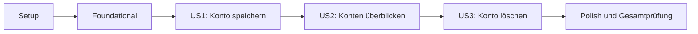

---
description: "Implementation tasks for Android school-account management"
---

# Tasks: Registerkonten auf Android verwalten

**Input**: Design documents from `specs/001-registerkonten-verwalten/`

**Prerequisites**: [plan.md](plan.md), [spec.md](spec.md), [research.md](research.md),
[data-model.md](data-model.md), [UI contract](contracts/account-management-ui.md),
[quickstart.md](quickstart.md), Constitution 1.1.0

**Tests**: Automatisierte Tests für Speicherung, Migrationen, Validierung und
Fehlerfälle sind durch die Constitution und den Plan erforderlich. Die Testaufgaben
stehen vor den Implementierungsaufgaben der jeweiligen Story; zuerst den
fehlschlagenden Test nachweisen, dann die Funktion umsetzen.

**Organization**: US1 = Konto speichern (P1), US2 = Konten überblicken (P2),
US3 = Konto löschen (P2). `[P]` bezeichnet nur Aufgaben in verschiedenen
Dateien ohne Abhängigkeit auf noch offene Aufgaben.

## Phase 1: Setup (Shared Infrastructure)

**Purpose**: Ein baubares, einzelnes Android-App-Projekt schaffen.

- [X] T001 Gradle-Wrapper, `settings.gradle.kts`, `build.gradle.kts` und `gradle/wrapper/gradle-wrapper.properties` für ein einzelnes App-Modul anlegen; stabile zueinander kompatible Kotlin-/AGP-Versionen anhand von `research.md` festschreiben.
- [X] T002 `gradle/libs.versions.toml` und `app/build.gradle.kts` für Kotlin, Compose, Lifecycle, Coroutines, Room 2.8.5, KSP sowie JUnit/Android-Instrumentierung konfigurieren; `minSdk 23`, `compileSdk 36`, `targetSdk 36`, Room-Schemaexport nach `app/schemas/` setzen.
- [X] T003 [P] Android-spezifische Build-Ausgaben und lokale SDK-Pfade in `.gitignore` ausschließen, ohne `app/schemas/` auszuschließen.
- [X] T004 `app/src/main/AndroidManifest.xml`, `app/src/main/java/com/familyhub/app/MainActivity.kt` und `app/src/main/java/com/familyhub/app/ui/theme/FamilyHubTheme.kt` als startbares Compose-Grundgerüst ohne Server- oder Internet-Berechtigung anlegen; `./gradlew.bat assembleDebug` aus dem Repository-Stamm muss gelingen.

---

## Phase 2: Foundational (Blocking Prerequisites)

**Purpose**: Plattformregeln und Testbasis bereitstellen, auf denen alle Stories aufbauen.

**Checkpoint**: Diese Phase muss vor den Story-Aufgaben abgeschlossen sein.

- [X] T005 `app/src/main/res/xml/backup_rules.xml`, `app/src/main/res/xml/data_extraction_rules.xml` und `app/src/main/AndroidManifest.xml` so konfigurieren, dass die Kontendatenbank weder in Cloud-Backups noch in Geräteübertragungen landet; Android 12+ und ältere unterstützte Versionen abdecken.
- [X] T006 [P] Nicht exportierbaren AES-GCM-Schlüssel im Android Keystore und Verschlüsselung mit frischem IV in `app/src/main/java/com/familyhub/app/security/CredentialsCipher.kt` kapseln; Benutzername und Passwort dürfen bei Fehlern nicht protokolliert werden.
- [X] T007 [P] Gemeinsam nutzbare UI-Texte für Schulen, Pflichtfelder, Duplikate und Speicherfehler in `app/src/main/res/values/strings.xml` anlegen; keine Zugangsdaten in Fehlermeldungen aufnehmen.
- [X] T008 [P] Android-Testbasis für isolierte Room-Datenbanken und instrumentierte UI-Tests in `app/src/androidTest/java/com/familyhub/app/TestDatabaseFactory.kt` bereitstellen; nur erfundene Registerdaten verwenden.

---

## Phase 3: User Story 1 - Schulkonto für ein Kind speichern (Priority: P1) 🎯 MVP

**Goal**: Ein Konto pro Kind offline anlegen, geschützt speichern und nach
App-Neustart wiederfinden.

**Independent Test**: Im Flugmodus ein Konto anlegen, App beenden und neu
starten; Kind und Schule erscheinen genau einmal, Zugangsdaten nicht.

### Tests for User Story 1

- [X] T009 [P] [US1] Fehlende oder nur aus Leerzeichen bestehende Pflichtangaben, `Anna`/` anna `/`ANNA` als gleiche Kinderkennung und unbekannte Schulwerte in `app/src/test/java/com/familyhub/app/data/accounts/AccountInputValidatorTest.kt` zunächst fehlschlagend testen.
- [X] T010 [P] [US1] Eindeutigkeit von `child_key`, Speicherung von zehn Konten, Neustart-Persistenz, fehlgeschlagene Verschlüsselung ohne Teilkonto und Chiffrat statt Klartext in `app/src/androidTest/java/com/familyhub/app/data/accounts/AccountCreationTest.kt` zunächst fehlschlagend testen.
- [X] T011 [P] [US1] Formular, Feldfehler, Offline-Anlage und sichtbares Kind/Schule nach Neustart gemäß `contracts/account-management-ui.md` in `app/src/androidTest/java/com/familyhub/app/ui/accounts/CreateAccountScreenTest.kt` zunächst fehlschlagend testen.

### Implementation for User Story 1

- [X] T012 [US1] `SchoolAccountEntity.kt` und `School.kt` in `app/src/main/java/com/familyhub/app/data/accounts/` anlegen: `id` „Automatisch erzeugt; Primärschlüssel“, `child_display_name` „Getrimmt, nicht leer; einzige sichtbare Personenbezeichnung“, `child_key` „Eindeutig indexiert; aus `child_display_name` abgeleitet“, `school_code` „Nur `grundschule` oder `mittelschule`“, `credentials_ciphertext` „Nicht leer; niemals als UI-Feld geladen“, `credentials_iv` „Pro Verschlüsselung neu; zusammen mit Chiffrat gespeichert“, `credentials_format_version` „Anfangswert `1`; ermöglicht spätere Formatmigration“.
- [X] T013 [US1] `AccountDao.kt` und `FamilyHubDatabase.kt` in `app/src/main/java/com/familyhub/app/data/accounts/` mit `school_accounts`, Schema-Version 1, eindeutigem `child_key`-Index, Insert und Konto-Projektion nur aus `id`, `child_display_name`, `school_code` anlegen; initiales Schema unter `app/schemas/` exportieren, keinen destruktiven Migrations-Fallback verwenden.
- [X] T014 [US1] Kindernamen per Trim, Unicode-NFC und sprachneutraler Kleinschreibung zu `child_key` normalisieren sowie Kind, Benutzername und Passwort auf nicht leer/nicht nur Leerzeichen prüfen in `app/src/main/java/com/familyhub/app/data/accounts/AccountInputValidator.kt`; Benutzernamen und Passwort vor Verschlüsselung unverändert lassen.
- [X] T015 [US1] Anlage in `app/src/main/java/com/familyhub/app/data/accounts/AccountRepository.kt` umsetzen: nur `grundschule`/`mittelschule` akzeptieren, Benutzername und Passwort als versionierten Inhalt mit `CredentialsCipher.kt` verschlüsseln, Chiffrat und Metadaten gemeinsam speichern und Duplikat-/Keystore-/Datenbankfehler ohne Zugangsdaten an die UI melden.
- [X] T016 [US1] Datenbank, Cipher und Repository in `app/src/main/java/com/familyhub/app/FamilyHubApplication.kt` bereitstellen und App-Klasse in `app/src/main/AndroidManifest.xml` registrieren; keine Netzwerkverbindung oder Registerprüfung beim Speichern auslösen.
- [X] T017 [US1] Formularzustand und Speichern-Aktion in `app/src/main/java/com/familyhub/app/ui/accounts/CreateAccountViewModel.kt` sowie Eingabefelder mit geschütztem Passwortfeld in `app/src/main/java/com/familyhub/app/ui/accounts/CreateAccountScreen.kt` umsetzen; Feldfehler und Duplikate verständlich anzeigen.
- [X] T018 [US1] `app/src/main/java/com/familyhub/app/MainActivity.kt` und `app/src/main/java/com/familyhub/app/ui/accounts/AccountListScreen.kt` um minimale Navigation, Hinzufügen-Aktion und Anzeige des gespeicherten Kindes mit Schule ergänzen; nach Neustart den lokalen Datensatz erneut laden und nie Benutzername oder Passwort anzeigen.

**Checkpoint**: T009–T011 bestehen; die P1-Story lässt sich ohne US2/US3 und
ohne Server demonstrieren.

---

## Phase 4: User Story 2 - Gespeicherte Konten überblicken (Priority: P2)

**Goal**: Alle Konten offline genau einmal, mit Leerzustand und ehrlichem
Lesefehler darstellen.

**Independent Test**: Zwei vorbereitete Konten offline öffnen; beide Kinder
mit Schule sehen, ohne Zugangsdaten. Bei leerer Datenbank den Einstiegshinweis
sehen; ein Lesefehler darf nicht als leere Liste erscheinen.

### Tests for User Story 2

- [X] T019 [P] [US2] Projektion ohne Chiffrat, genau eine Zeile je Konto, zehn Konten nach Neustart und Datenbank-Lesefehler in `app/src/androidTest/java/com/familyhub/app/data/accounts/AccountOverviewTest.kt` zunächst fehlschlagend testen.
- [X] T020 [P] [US2] Leerzustand, Mehrfachliste, verständlichen Lesefehler, Passwortfreiheit und vergrößerte Schrift in `app/src/androidTest/java/com/familyhub/app/ui/accounts/AccountListScreenTest.kt` zunächst fehlschlagend testen.

### Implementation for User Story 2

- [X] T021 [US2] Die in US1 angelegte Projektion als nach Kind geordnete, beobachtbare Abfrage in `app/src/main/java/com/familyhub/app/data/accounts/AccountDao.kt` erweitern; Chiffrat/IV/Formversion dürfen nicht Teil des UI-Modells sein.
- [X] T022 [US2] Beobachtbare Kontenliste und unterscheidbare Leseergebnisse in `app/src/main/java/com/familyhub/app/data/accounts/AccountRepository.kt` ergänzen; Datenbankfehler nicht als leere Liste abbilden.
- [X] T023 [US2] Listen-, Leer-, Lade- und Fehlerzustand samt erneutem Versuch in `app/src/main/java/com/familyhub/app/ui/accounts/AccountListViewModel.kt` umsetzen.
- [X] T024 [US2] `app/src/main/java/com/familyhub/app/ui/accounts/AccountListScreen.kt` um mehrere Konten, Leerzustand, Lesefehler und zugängliche Beschriftungen bei vergrößerter Schrift erweitern; keine Zugangsdaten und keinen erfundenen Abgleichstatus anzeigen.

**Checkpoint**: T019–T020 bestehen; US2 ist mit vorbereiteten Konten unabhängig
von der Anlegeoberfläche prüfbar.

---

## Phase 5: User Story 3 - Schulkonto löschen (Priority: P2)

**Goal**: Ein Konto nach Bestätigung vollständig entfernen, Abbruch folgenlos
lassen und Neueinrichtung für dasselbe Kind erlauben.

**Independent Test**: Vorbereitetes Konto offline erst mit Abbruch behalten,
dann bestätigt löschen; nach Neustart bleibt es weg und kann neu angelegt werden.

### Tests for User Story 3

- [X] T025 [P] [US3] Erfolgreiche Löschung, erneute Anlage desselben `child_key`, Erhalt anderer Konten und Rollback bei Löschfehler in `app/src/androidTest/java/com/familyhub/app/data/accounts/AccountDeletionTest.kt` zunächst fehlschlagend testen.
- [X] T026 [P] [US3] Dialog mit Kind/Schule, Abbrechen ohne Datenänderung, bestätigte Löschung und verständliche Fehlermeldung ohne Zugangsdaten in `app/src/androidTest/java/com/familyhub/app/ui/accounts/DeleteAccountDialogTest.kt` zunächst fehlschlagend testen.

### Implementation for User Story 3

- [X] T027 [US3] Löschung nach stabiler Konto-ID in `app/src/main/java/com/familyhub/app/data/accounts/AccountDao.kt` ergänzen; Konto und künftig referenzierende Einträge über Fremdschlüssel mit `ON DELETE CASCADE` als eine Datenbanktransaktion behandeln.
- [X] T028 [US3] Bestätigte Löschung und Fehlerabbildung in `app/src/main/java/com/familyhub/app/data/accounts/AccountRepository.kt` ergänzen; bei Fehler vorherigen Zustand erhalten und nach Erfolg keine Zugangsdaten oder Kontozeile mehr zurückgeben.
- [X] T029 [US3] Lösch-Auswahl, Bestätigung, Abbruch und Fehlerzustand in `app/src/main/java/com/familyhub/app/ui/accounts/AccountListViewModel.kt` ergänzen.
- [X] T030 [US3] „Schulkonto löschen“ und Dialog mit Kind/Schule, „Abbrechen“ und „Löschen“ in `app/src/main/java/com/familyhub/app/ui/accounts/AccountListScreen.kt` einbauen; andere Konten unverändert lassen.

**Checkpoint**: T025–T026 bestehen; US3 ist mit einem vorbereiteten Konto
unabhängig vom Anlegeformular prüfbar.

---

## Phase 6: Polish & Cross-Cutting Concerns

**Purpose**: Sicherheits- und Release-Nachweise für alle drei Stories abschließen.

- [X] T031 [P] Room-Schema-Version 1 und künftige Migrationsfähigkeit mit `app/schemas/` in `app/src/androidTest/java/com/familyhub/app/data/accounts/SchemaMigrationTest.kt` prüfen; keinen Datenverlust-Fallback zulassen.
- [X] T032 [P] Manifest und Backup-Regeln für Android 12+ sowie ältere unterstützte Versionen in `app/src/androidTest/java/com/familyhub/app/security/BackupRulesTest.kt` prüfen; `school_accounts` darf weder Cloud- noch Geräteübertragungs-Backup erreichen.
- [X] T033 [P] Verschlüsselungs- und Geheimnisschutz mit erfundenen Zugangsdaten in `app/src/androidTest/java/com/familyhub/app/security/CredentialsCipherTest.kt` prüfen: Chiffrat statt Klartext, frisches IV je Anlage, keine Klartextwerte in Datenbank oder Fehlertexten.
- [X] T034 [P] UI-Semantik und Bedienbarkeit bei vergrößerter Android-Schrift in `app/src/androidTest/java/com/familyhub/app/ui/accounts/AccountAccessibilityTest.kt` prüfen; Kind, Schule, Speichern und Löschen müssen auffindbar bleiben.
- [X] T035 `app/src/main/AndroidManifest.xml` auf ausschließlich benötigte Berechtigungen und fehlende Register-/Server-Abhängigkeit prüfen; `app/src/main/java/com/familyhub/app/` auf Klartext-Logs, Absturzberichte und unbeabsichtigte Zugangsdatenanzeige durchsuchen.
- [X] T036 `./gradlew.bat testDebugUnitTest`, `./gradlew.bat connectedDebugAndroidTest` und `./gradlew.bat assembleDebug` ausführen; die manuellen Offline-, Neustart- und Löschschritte aus `specs/001-registerkonten-verwalten/quickstart.md` prüfen und Ergebnisse in `specs/001-registerkonten-verwalten/verification.md` dokumentieren.

---

## Dependencies & Execution Order

### Phase Dependencies

- Setup (T001–T004) startet zuerst. T002 benötigt T001; T004 benötigt T002.
- Foundational (T005–T008) benötigt Setup und blockiert alle Story-Phasen.
- US1 (T009–T018) benötigt Foundational. T009–T011 entstehen vor T012–T018.
- US2 (T019–T024) benötigt US1-Datenmodell und Repository aus T012–T015;
  UI-Arbeit benötigt zusätzlich T018. Tests T019–T020 stehen vor der
  US2-Implementierung.
- US3 (T025–T030) benötigt US1-Datenmodell/Repository; UI-Arbeit nutzt die
  US2-Übersicht. Tests T025–T026 stehen vor der US3-Implementierung.
- Polish (T031–T036) benötigt die jeweils betroffenen Stories; T036 folgt
  allen übrigen Aufgaben.

### User Story Dependencies

- **US1 (P1)**: Nach Foundational eigenständig lieferbar; dies ist der MVP.
- **US2 (P2)**: Die Daten können für den unabhängigen Test vorbereitet werden;
  die Umsetzung erweitert den mit US1 begonnenen Kontenabruf.
- **US3 (P2)**: Die Daten können für den unabhängigen Test vorbereitet werden;
  die Umsetzung nutzt Konto-ID und Übersicht aus US1/US2.



### Within Each User Story

- Testdateien zuerst schreiben und fehlschlagend ausführen.
- Entität und DAO vor Repository; Repository vor ViewModel; ViewModel vor UI.
- Story-Checkpoint erst nach bestandenen Story-Tests als abgeschlossen markieren.

### Parallel Opportunities

- T003 kann nach T001 unabhängig von T002 erfolgen.
- T006–T008 arbeiten nach T004 in getrennten Dateien; T005 berührt das Manifest
  und wird vor UI-Integration abgeschlossen.
- T009–T011, T019–T020 und T025–T026 können innerhalb ihres Story-Starts
  jeweils in verschiedenen Testdateien bearbeitet werden.
- T031–T034 prüfen voneinander getrennte Aspekte in verschiedenen Dateien.

## Parallel Example: User Story 1

```text
Nach T008: T009 Validator-Tests | T010 Datenbank-/Keystore-Tests | T011 UI-Tests
Danach: T012 Entity → T013 DAO/DB → T014 Validator → T015 Repository → T016–T018 UI
```

## Parallel Example: User Story 2

```text
Nach T018: T019 Datenprojektion/Fehler-Tests | T020 Übersicht/Schrift-Tests
Danach: T021 DAO → T022 Repository → T023 ViewModel → T024 Übersicht
```

## Parallel Example: User Story 3

```text
Nach US2: T025 Lösch-/Rollback-Tests | T026 Dialog-Tests
Danach: T027 DAO → T028 Repository → T029 ViewModel → T030 Dialog
```

## Implementation Strategy

### MVP First (User Story 1 Only)

1. Setup und Foundational abschließen.
2. US1-Tests schreiben und rot laufen lassen; T012–T018 implementieren.
3. US1 im Flugmodus mit App-Neustart prüfen. Konto muss geschützt gespeichert
   sein und mit Kind/Schule wieder erscheinen.

### Incremental Delivery

1. US2 ergänzt Mehrfachübersicht, Leerzustand und Lesefehler, ohne den
   Anlageweg zu verändern.
2. US3 ergänzt bestätigte Löschung und Neueinrichtung für dasselbe Kind.
3. Polish führt Sicherheits-, Schema-, Barrierefreiheits- und Quickstart-Prüfung
   vor dem Abschluss aus.

## Notes

- Die bestätigte Ein-Konto-Regel in `spec.md` hat für dieses Feature Vorrang vor
  der älteren Formulierung in `docs/android-feature-list.md`.
- Registerabgleich, Bearbeiten, Export/Import, Benachrichtigungen und
  geräteübergreifende Synchronisierung sind nicht Bestandteil dieser Aufgaben.
- T031 prüft das erste exportierte Schema; sobald eine spätere Version entsteht,
  sind explizite Migration und ein Test mit vorheriger Datenversion Pflicht.

## Phase 7: Convergence

- [X] T037 Ersetze die `writeUTF`/`readUTF`-Kodierung in `app/src/main/java/com/familyhub/app/security/CredentialsCipher.kt` durch ein längensicheres, versioniertes Format; prüfe Verschlüsselung, Entschlüsselung und dauerhaftes Speichern mit Zugangsdaten über 65.535 UTF-Bytes und Sonderzeichen per FR-002 (partial).
- [X] T038 Prüfe in `app/src/androidTest/java/com/familyhub/app/ui/accounts/AccountAccessibilityTest.kt` bei vergrößerter Android-Schrift die tatsächliche Sichtbarkeit, Scroll-Erreichbarkeit und Bedienbarkeit von Kind, Schule, Speichern und Löschen auch auf kleinem Bildschirm; behebe dabei festgestellte UI-Probleme per FR-013 (partial).
- [X] T039 Miss auf einem unterstützten Android-Testgerät die Zeit bis zur sichtbaren Übersicht mit zehn Konten sowie die Dauer von Speichern und Löschen; dokumentiere die Ergebnisse und behebe Überschreitungen der Grenzen von einer beziehungsweise zwei Sekunden per plan: Performance Goals (missing).
- [X] T040 Führe die Instrumentierungstests und den Offline-/Neustart-/Löschablauf auf Android API 23 aus; behebe auftretende Kompatibilitätsfehler und dokumentiere das Ergebnis in `specs/001-registerkonten-verwalten/verification.md` per plan: Target Platform (partial).
